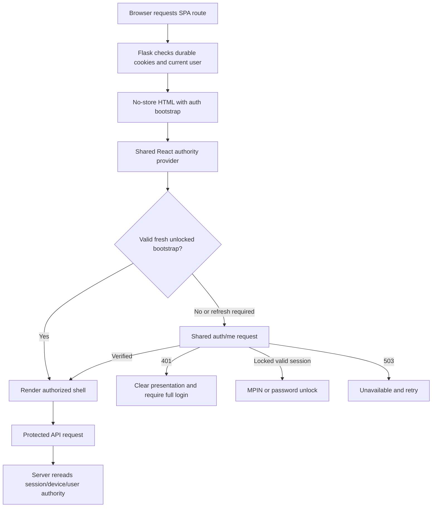

# Auth system full map — current local source

Final reconciliation completed **28 October 2026 (Asia/Karachi)**; test execution and source evidence below were captured on 27 October.

Updated **27 October 2026 (Asia/Karachi)**. This is an architecture map, not a list of unresolved bugs. Open defects are in [AUTH_AUDIT.md](AUTH_AUDIT.md). The old no-revocation, duplicate-guard-lookup and unused-bootstrap descriptions have been replaced.

## Authority and state ownership

| Owner | State and responsibility |
|---|---|
| Supabase Auth | Provider identity and password verification/update. Flask creates and validates its own durable sessions. |
| `users` | Canonical identity, effective role, blocked state, credential generation and password-change pending gate. Browser writes cannot grant privileged role/identity authority. |
| `trusted_devices` | Hashed random device credential, user binding, expiry, rotation/revocation. |
| `user_sessions` | Hashed session credential, exact user/device binding, inactivity/absolute deadlines, access-lock/proof state, password verification and revocation. |
| Credential-change service | Serializes password operations, revokes sessions/devices before provider I/O, and gates ambiguous provider outcomes until explicit reconciliation. |
| MPIN service | Hashed/peppered PIN, failure counter and lock state. MPIN unlock restores access proof for an existing eligible session; it does not replace full login. |
| Step-up service | Short-lived, action/resource/amount/destination-bound authorization consumed by protected mutations. |
| Flask signed session | CSRF token and presentation/activity metadata; it is not sufficient authority for a protected API request. |
| AuthVerificationContext / AccessLockProvider | Shared React authority/presentation lifecycle, bootstrap hydration, refresh generation/cancellation, lock UI and login transitions. |
| sessionStorage / assistant/cart stores | Non-authoritative UI/cache state. Sensitive signup credentials remain in the wizard's bounded lifetime; account-scoped cart/assistant data does not confer access. |

## Cookies and time limits

The durable session, trusted-device and access-proof cookies use HttpOnly, SameSite=Lax and Path=/; Secure follows the explicit environment policy. Only local loopback/test mode can use non-Secure cookies or the local fallback Flask secret. No actual secret values are recorded here.

| Contract | Current source value |
|---|---|
| Absolute session lifetime | 30 days |
| Sliding inactivity lifetime | 7 days, capped by absolute expiry |
| Access proof | Up to 8 hours, capped by session expiry |
| Genuine activity write throttle | 12 hours; ordinary polling is not genuine user activity |
| Trusted-device configured lifetime | Bounded 1–30 days, default 30 |
| Password reset OTP | 10-minute expiry; 5 wrong attempts |
| Reset authorization | 10-minute validity; claim/finalization prevents simple replay |
| MPIN failure lock | 5 failures |
| Step-up proof | 180 seconds |
| Frontend/HTML bootstrap freshness | 15 minutes, with access-proof bounds in the HTML payload |

Sources: `backend/auth/session_service.py`, `trusted_device_service.py`, `mpin_service.py`, `step_up_service.py`, `helpers.py`, `security_config.py`; `backend/app.py`; `frontend-react/src/components/security/AccessLockProvider.jsx`. An OTP-attempt cooldown does not supply the missing reset-issuance limiter in AUTH-05.

## Current request lifecycle

Bootstrap is created by `_bootstrap_auth_from_session`, including access-proof input; it is consumed by `initialAuthorityFromBootstrap`. `/auth/me` refresh ownership lives in AccessLockProvider. Client/everyday/transporter/shopkeeper/admin guards consume shared verified state. Page-data requests and MPIN settings may make their own domain calls, but the former assertion that every role guard independently blocks on `/auth/me` is no longer correct.

Server `login_required` rejects invalid/revoked/expired/blocked/pending authority, persists access lock within the checked-out database context and returns a structured lock response where required. Routes explicitly allowed during lock continue their limited functions. Database outages do not masquerade as successful logout or permanent credential expiry.

## Signup, login and role terms

1. Role selection leads to a server-versioned role-specific terms document and acceptance.
2. Signup validates role/data/terms, provisions provider identity and local profile, records acceptance, and creates the trusted-device/session state under credential-generation safeguards.
3. Login verifies the exact supplied password and current provider identity, then rechecks local generation/pending/block state before issuing a durable session.
4. Normal and admin login refresh shared React authority before navigation. Server role checks remain required on business endpoints.

Malformed signup shape and random driver-code collision are still open; see AUTH-06 and DB-15. This map does not imply every signup branch is error-free.

## Logout and credential changes

- Current logout revokes the session and required security event in one transaction; success clears authentication. Failure returns retryable 503.
- Logout-all and device/session removal use owner-scoped reference checks and revocation services. A local UI cache cannot authorize a revoked server request.
- Reset and authenticated password change call `execute_password_change`. Its initial transaction increments generation, marks pending and revokes all sessions/devices before provider I/O. Finalization only clears the appropriate completed generation. Unknown outcomes remain pending.
- The operator reconciliation CLI requires the exact user/generation and a terminal-provider attestation. It does not resurrect the old sessions or infer success just from a timeout.

## Auth route inventory

The following is generated from the current registered auth blueprint. `backend/app.py` additionally exposes the same blueprint under `/api/auth` as a compatibility namespace. Endpoint existence does not imply public access; decorators and per-route checks define that contract.

| Methods | Path | Handler |
|---|---|---|
| `GET` | `/auth/csrf-token` | `auth.csrf_token` |
| `GET` | `/auth/signup-terms` | `auth.signup_terms` |
| `POST` | `/auth/signup` | `auth.signup` |
| `POST` | `/auth/login` | `auth.login` |
| `GET` | `/auth/me` | `auth.auth_me` |
| `GET` | `/auth/security/sessions` | `auth.active_security_sessions` |
| `GET` | `/auth/security/devices` | `auth.active_security_devices` |
| `DELETE` | `/auth/security/sessions/<string:management_ref>` | `auth.revoke_security_session` |
| `DELETE` | `/auth/security/devices/<string:management_ref>` | `auth.revoke_security_device` |
| `POST` | `/auth/session/activity` | `auth.genuine_session_activity` |
| `POST` | `/auth/logout` | `auth.logout` |
| `POST` | `/auth/logout-all` | `auth.logout_all` |
| `POST` | `/auth/forgot-password` | `auth.forgot_password` |
| `POST` | `/auth/password-reset/verify-otp` | `auth.verify_password_reset_otp` |
| `POST` | `/auth/reset-password` | `auth.reset_password` |
| `GET` | `/auth/fast-login/options` | `auth.fast_login_options` |
| `POST` | `/auth/fast-login/mpin` | `auth.fast_login_mpin` |
| `POST` | `/auth/fast-login/setup` | `auth.setup_fast_login` |
| `POST` | `/auth/fast-login/disable` | `auth.disable_fast_login` |
| `GET` | `/auth/mpin/status` | `auth.mpin_status` |
| `POST` | `/auth/mpin/enroll` | `auth.mpin_enroll` |
| `POST` | `/auth/mpin/unlock` | `auth.mpin_unlock` |
| `POST` | `/auth/access/unlock/password` | `auth.password_unlock` |
| `POST` | `/auth/mpin/password-unlock` | `auth.password_unlock` |
| `POST` | `/auth/mpin/change` | `auth.mpin_change` |
| `POST` | `/auth/mpin/disable` | `auth.mpin_disable` |
| `POST` | `/auth/mpin/step-up` | `auth.mpin_step_up` |
| `POST` | `/auth/mpin/reset` | `auth.mpin_reset` |

## Security/operational boundaries

State-changing authenticated handlers use the existing CSRF transport. Selected financial, delivery and account-wide actions additionally require action-bound step-up. Locked auth presentation is intentionally available to the unlock flow. Provider errors and configuration outages must be distinguished from credential failure. Reset issuance still lacks application admission limits; forwarded request metadata is not a substitute for a trusted limiter key.

The current [evidence receipt](docs/audit-evidence/2026-10-27/README.md) records local tests and their failures. Remote configuration, deployment parity, real email/payout gateways and browser performance were not revalidated in this map refresh.
