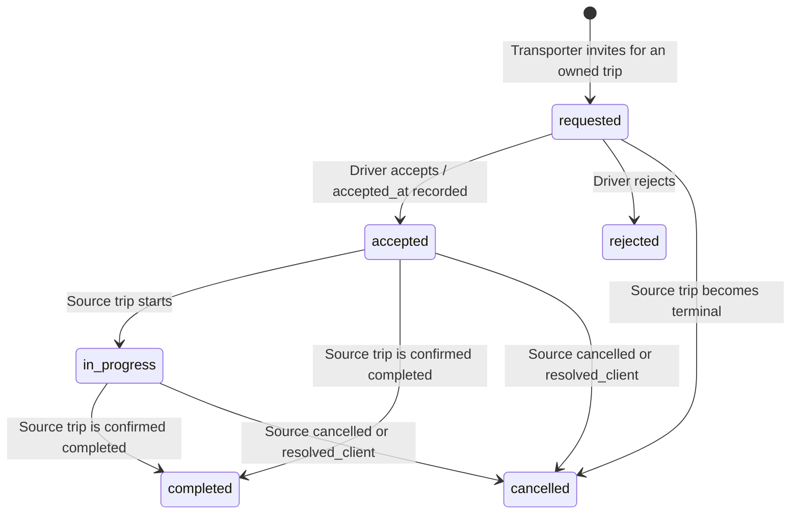

# Digi_TransX remaining-issue remediation — 25 October 2026

This batch implements the owner's additional 15-point list, covering 16 audit
IDs because the query-performance item includes both PERF-01 and DB-11. FIN-08
and FIN-09 were already implemented in the preceding batch; their controls were
retained and verified again. The [audit report](../PROJECT_AUDIT_REPORT.md) now lists remaining findings
after the 27 October reconciliation; this file retains the dated implementation receipt. The [24 October record](SECURITY_REMEDIATION_2026-10-24.md)
describes the preceding changes; this file records the additional implementation.

## 1. Issue-by-issue disposition

| Item / audit ID | Implemented behavior | Main source and evidence |
|---|---|---|
| 1. BE-01 | Fleet creation, configuration and status mutation require a transporter role. A client, driver, shopkeeper or fuel-station account cannot create a truck even with valid authentication and CSRF. | `backend/trucks/routes.py`; five denied-role tests and both transporter aliases |
| 2. BE-02 | Truck registration never binds a visible driver ID or accepts caller-supplied driver identity as consent. Configuration cannot overwrite the accepted driver's identity. An owned-trip invitation followed by the driver's authenticated acceptance establishes the link and records `accepted_at`. | Truck/driver routes; fleet consent tests; actual invite/accept frontend panel |
| 3. BE-05 | Withdrawal locks shipment then bid, matching checkout, and changes only the caller's still-pending bid. A winning checkout cannot subsequently be overwritten by withdrawal. | `backend/orders/routes.py`; staged races against real `perform_checkout` in both winning orders |
| 4. FIN-08 | Existing request and wallet row locks remain in place for admin withdrawal approval. Concurrent approvals cannot spend the same available balance or marketplace/security hold. | Existing admin implementation; three repeated financial safeguards |
| 5. FIN-09 | All seven marketplace seller actions retain the shopkeeper guard before domain SQL. | Existing marketplace decorators; four unrelated roles × seven actual HTTP actions denied |
| 6. FIN-10 | A review needs the hiring transporter's consented, completed assignment and its actually completed source trip. One review per assignment/driver-trip is enforced by SQL uniqueness and locked application checks. Allegations start as `investigating`, with no automatic public theft label or penalty. | Driver route; provenance SQL guards; concurrent review and direct SQL forgery tests |
| 7. FIN-11 | Dispatch requires exactly one owned one-time/agreement trip and its matching owned truck. Related fuel joins also reject or hide malformed foreign assignment provenance. | Driver dispatch/context helpers, fuel endpoints; both trip types and legacy foreign-join tests |
| 8. FIN-12 | GPS requires a current consented active assignment. Server-side allocation determines truck and trip identifiers; supplied mismatches, invalid coordinates and terminal/stale trips are rejected. | Driver GPS route; derived-ID, foreign-ID, non-finite and stale-source tests |
| 9. FIN-13 | Acceptance follows trip → truck → profile → assignment locking, checks availability and competing work, and records consent atomically. Four partial unique indexes prevent concurrent active allocation of the same driver, truck or source trip. Terminal trip triggers release the driver and truck. | Driver routes and first new migration; real competing acceptance and direct 23505 index proof |
| 10. FIN-18 | Saving a first/default card updates the default preference in the same transaction. Owner `FOR NO KEY UPDATE` → advisory → domain locking serializes card/preference writers while permitting user foreign-key key-share locks. Existing auto-charge consent is preserved. | Shared payment service and payment routes; staged deadlock counterexamples/current-order proof; separate convergence migration |
| 11. PERF-01 / DB-11 | My Orders uses one grouped query. Sales list uses one sale query and one `ANY(sale_ids)` item query, or one query when empty. Ownership, zero counts, item ordering and validation remain enforced. | Orders/shopkeeper routes; measured query counts with 0, 1 and 25 records |
| 12. FE-005 | Chat message panes are keyed by verified account and thread. Generation checks and cancellation protect loads, polling and late mutations across rapid switches, including awaited CSRF work. | Chat component; deferred A/B/A, late-send and account-switch component tests |
| 13. FE-006 | Editing address text clears the old coordinates and selected pin. Earlier geocoder results cannot restore a stale location after an edit. | LocationPicker; manual-edit and delayed geocoder tests |
| 14. FE-007 | Agreement dates use calendar-only ISO operations with backend-compatible month clamping. Date labels do not convert local midnight through UTC. | Calendar helper and AgreementBids; month-end/leap-year tests across Karachi, UTC, New York and Auckland |
| 15. FE-013 | Cart storage and form lifetime are bound to the verified account. Account changes cancel delayed checkout work. Marketplace order creation requires an expected-account header matching the authenticated buyer before domain SQL. | Parts cart, checkout helper/consumers, marketplace route; storage, account-switch and delayed-checkout tests |

The truck role guard uses the shared transporter-role constants. Importing the
agreement router's helper from the truck router would create a package import
cycle; the final implementation avoids that dependency. Existing unrelated
working-tree changes were preserved.

## 2. Driver consent and authoritative lifecycle

Invitation creation reserves neither a driver nor a truck. Driver acceptance
checks the current source, fleet owner, truck, availability and competing active
allocations again under row locks. The new profile/vehicle binding and consent
timestamp commit together. A repeated pending invitation returns its existing ID.

The source trip is authoritative. A trip completion before an invitation was
accepted cancels that invitation; it never invents a completed driver contract.
Terminal changes update allocation status and release availability in the same
database transaction as the source transition. A rollback also rolls back those
side effects. The conservative contract retains a one-time allocation through
pending delivery confirmation/dispute until the source becomes terminal; a
transporter's completion claim alone does not establish a reviewable delivery.

The frontend now exposes the existing consent process through an owned-trip
panel in transporter order tracking and agreement trip/history views. It sends
invitations, shows their status and offers one completed-assignment review.
The driver's existing requests page accepts/rejects with CSRF. Its GPS console
tracks only an accepted allocation and stops when that allocation is no longer
authorized.

`GET /api/transporter/driver-assignments` accepts exactly one `trip_id` or
`agreement_trip_id`, checks the current fleet owner and returns safe assignment
state, driver name/code and review availability. It does not expose the driver's
CNIC, email, phone or license. Active/completed allocations sort first, so the
bounded list cannot hide the actionable allocation behind old rejected requests.

Reviews require `assignment_id` and `driver_user_id`; the server derives the
source trip and author from that assignment. New incidents begin investigating.
Historical rows without assignment proof are retained for investigation but
excluded from public reputation and penalties. Cached rating/count and stale
auto-links are reconciled without inventing historical consent. A profile with
no active allocation cannot remain falsely unavailable because its old truck
link disappeared. An operator moderation interface for investigating incidents
is separate work; this batch does not automatically declare an accusation true.

## 3. Database changes and authorized test rollout

Two new forward migrations were applied to the owner-authorized Supabase TEST
project `fysupkvuvhvtowbfgoev`:

1. `20261025010000_driver_workflow_integrity.sql`: consent/provenance columns,
   target/status/consent constraints, four active-allocation unique indexes,
   review uniqueness, attribution guards, lifecycle triggers, derived-profile
   reconciliation and the two owner/created list indexes.
2. `20261025020000_payment_preference_convergence.sql`: synchronize existing
   active default-card pointers. It uses the same owner/advisory lock order as
   application writes and rereads the default after locking. Existing automatic
   charge flags remain unchanged; a newly required preference starts with
   automatic charging disabled.

The canonical schema contains both files for fresh installations. The four
24 October migrations were verified against their recorded hashes and were not
edited. These two new files must also remain immutable after application.

Preflight found one driver profile and zero driver assignments, reviews or
incidents. There was no legacy consent to guess or double-booking winner to pick.
The migration explicitly aborts for existing active/completed assignments without
recorded consent, and real PostgreSQL tests prove that partial DDL rolls back in
that case. Unproven legacy review/incident rows are preserved in upgrade tests.

Post-rollout verification confirmed:

- All **68 public table row counts remained unchanged**, including financial and
  identity tables. All **68 retain RLS**.
- User identity/role bindings and every wallet amount/reserve/minimum fingerprint
  were unchanged. Existing automatic-charge consent was preserved; no new consent
  was granted.
- Three assignment checks are validated, all nine explicitly inspected allocation,
  review and list indexes are valid, and all four new triggers are enabled.
- Browser roles cannot execute the privileged trigger functions or insert the
  new review-provenance column directly.
- The deployed test data already had no default-card pointer mismatch or missing
  preference, so this rollout needed zero pointer repairs/new preference rows.
  Separate legacy fixtures prove both repair paths while preserving consent.

The first connection attempt failed before any SQL mutation; a fresh connection
probe succeeded and the retry committed both files. The failed attempt remains
recorded alongside the successful [rollout receipt](audit-evidence/2026-10-25/database-rollout.json).
No real payment, email, device location or external driver account action was
performed by the test suite.

## 4. Checkout account binding and client compatibility

Namespace isolation alone does not prevent a delayed form from obtaining the
next account's CSRF token. Checkout now cancels work after account change, checks
again after Web Crypto and immediately before dispatch, and sends
`X-DTX-Expected-User-Id` from the verified account. The server compares it with
the cookie-authenticated user before opening the marketplace transaction.

The header is required on `POST /api/marketplace/orders` alongside the existing
CSRF and idempotency headers. Missing/malformed account binding returns 400
`checkout_account_required`; a changed account returns 409
`checkout_account_changed`. It is a consistency assertion, never an authorization
source: the server still derives the buyer from its authenticated session.
Frontend assets and this API contract should be released together; an older tab
must reload before creating a new marketplace order. Stock and funds are not
touched for an unbound/mismatched request.

Unowned legacy cart storage is not imported into the next account. CSRF cache
generation invalidation also prevents an older account's delayed token request
from repopulating the cache after logout.

## 5. Validation and limits

- **114 passed** in the final fleet/database/driver selection: 64 fresh/upgrade/
  replay authorization checks, 32 driver workflow cases and 18 fleet/provenance/
  legacy-card cases.
- **81 passed** across marketplace account binding, existing coordinate integrity
  and premerge route security, including nine real-authenticated account-header
  cases that reject before marketplace transaction work.
- **21 passed** in the final focused order/card/performance and retained admin
  controls, including the additional wallet-credit/checkout lock regression.
  Query counts are measured separately from authentication queries. The earlier
  20-case run predates this additional test.
- **157 passed** in existing payments and commissions. The existing routes module
  passed 35 cases initially; its one missing-owner fixture was corrected, and the
  unchanged concurrency case passed on rerun. A full second module run was not
  needed. Payment tests now seed their real owner rows rather than relying on
  nonexistent accounts.
- The old advisory-first card lock was reproduced only through an in-process test
  replacement and produced PostgreSQL 40P01. The current owner-first implementation
  passed that staged scenario. See the [payment/query receipt](audit-evidence/2026-10-25/order-payment-performance-verification.md).
- The final review also reproduced a user-row `FOR UPDATE` versus wallet-credit
  foreign-key cycle as 40P01. The new guard now takes `FOR NO KEY UPDATE`: it
  serializes card writers without blocking the implicit user `KEY SHARE` lock of
  a concurrent wallet-transaction insert. The staged real credit and checkout
  both commit with reconciled wallet/transaction amounts. This does not downgrade
  a stronger owner lock already held by another authentication/MPIN operation,
  and does not claim to eliminate every system-wide lock cycle. The two applied
  migrations remain unchanged.
- **103/103 Node tests** and **63/63 rendered component tests** passed, including
  29 new component cases for the remaining workflow changes. The production build
  passed with 976 modules and 14 output files totaling 3,031,514 bytes. No
  `dist/node_modules` dependency tree was copied. The main JavaScript chunk is
  still large; a successful build is not a load-time performance measurement.
- Touched-source ESLint checked 18 files and found **zero new errors**, with two
  existing unused-variable errors in `truck_configuration.jsx` reproduced against
  Git HEAD, plus one retained effect-dependency warning in `PartsMarketplace.jsx`.
  This is not a clean whole-project lint result. See the
  [frontend verification record](audit-evidence/2026-10-25/frontend-verification.txt)
  for commands, baseline comparison and raw logs.

Final artifact packaging found the existing `dist` size differed from the earlier
frontend receipt. The complete Node/component suites and production build were
therefore repeated on the final source: 103 and 63 tests passed again, and the
build succeeded in 13.44 seconds. Current logs record those reruns; the earlier
8.42-second build log is retained separately. The final output size above comes
from the rebuilt directory, not the earlier receipt.

All **165 backend Python files** parsed successfully without importing application
modules. `git diff --check` passed. A [440-file SHA-256 source manifest](audit-evidence/2026-10-25/source-sha256.json)
records the verified backend, frontend, test, build-control and SQL files. All six
applied remediation migration hashes match their recorded receipts; the canonical
schema's new tail exactly mirrors both 25 October migration files. The
[machine-readable verification summary](audit-evidence/2026-10-25/verification-summary.json)
and [fleet/database/checkout receipt](audit-evidence/2026-10-25/fleet-database-checkout-verification.md)
link the final selected results and their limits.

Selections overlap and must not be summed as unique coverage. Backend integration
uses disposable loopback PostgreSQL, real row locks/constraints and fake external
boundaries; the application database URL is deliberately invalid in those test
processes. Remote migration/role verification is separately scoped to the
authorized test project. No second whole-backend run is claimed for this batch.
The task's synthetic PostgreSQL runner on loopback port 15477 was shut down after
verification, and the absence of a listener was checked. Its data directory was
retained; unrelated local database processes were not stopped.

The original audit's remaining findings, live gateway/payout integration,
double-entry ledger, device/hardware validation and production-load benchmarks
remain separate work. Constant query count does not establish production latency
or replace pagination/retention planning.
